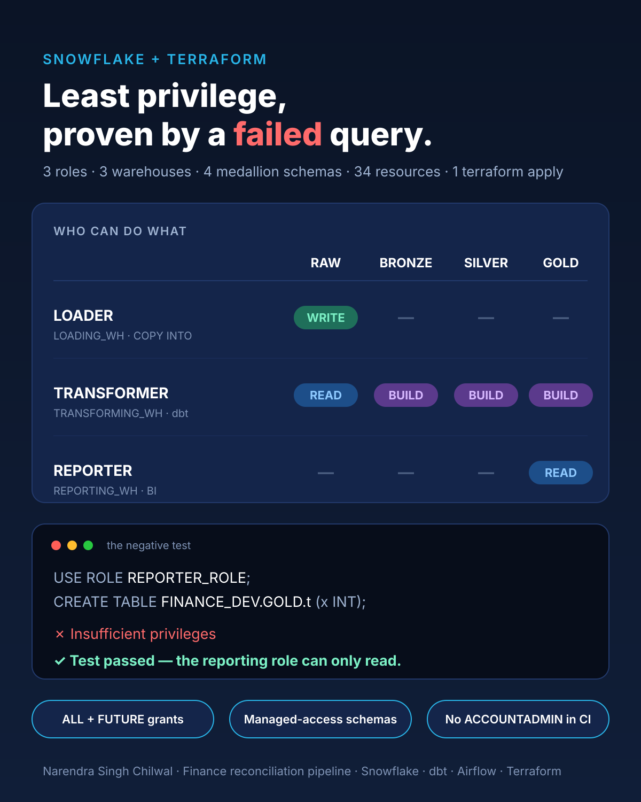

# Finance Reconciliation Pipeline

An end-to-end data pipeline that reconciles **purchase orders, goods receipts, supplier invoices and payments**, the classic
finance *3-way match*, and flags the exceptions a finance team actually cares about.

Built as a production-patterned portfolio project: every piece of infrastructure is Terraform, every access path is least-privilege,
and every design decision has a written "why".



---

## What it does

```
 Synthetic generator ──► S3 (batch CSVs) ──► COPY INTO ──► Snowflake RAW
                                                              │
 Payments ──► Kafka (MSK Serverless) ──► consumer ──► MERGE ──┘
                                                              │
                                     dbt:  RAW ─► BRONZE ─► SILVER ─► GOLD
                                                                       │
                                     3-way match + exception detection ┘

 Airflow orchestrates the data flow · GitHub Actions handles code CI/CD · Terraform owns all infrastructure
```

The raw data carries **nine kinds of anomaly, none of them labelled**. The Gold layer has to *detect* them, just as it would in the real world:

- receipt quantity ≠ PO quantity
- invoice amount ≠ PO line total
- invoice currency ≠ PO currency
- invoice with no PO
- invoice against a cancelled PO
- duplicate invoice submissions
- late payments
- partial payments
- supplier bank or payment-terms changes (SCD Type 2)

## Stack

| Layer | Tool |
|---|---|
| Infrastructure as code | Terraform (AWS + `snowflakedb/snowflake` 2.x providers) |
| Storage / landing | AWS S3 (versioned, encrypted, public access blocked) |
| Streaming | AWS MSK Serverless (Kafka) |
| Warehouse | Snowflake (Enterprise) |
| Transformation | dbt |
| Orchestration | Apache Airflow (Docker Compose) |
| CI/CD | GitHub Actions |
| Language / tests | Python 3.11, pytest |

## Status

This is being built in phases, and the table shows where it really stands.

| Phase | What | Status |
|---|---|---|
| 0 | Environment, git hygiene, AWS budget alert | ✅ Done |
| 1 | S3 bucket + least-privilege IAM loader user (Terraform) | ✅ Done |
| 2 | Snowflake foundation: warehouses, database, schemas, RBAC (Terraform) | ✅ Done |
| 3 | Seedable synthetic data generator + pytest suite (24 tests) | ✅ Done |
| 4 | Batch ingestion: storage integration, stages, COPY INTO | 🔜 Next |
| 5 | Streaming payments: Kafka → idempotent MERGE on `payment_id` | ⏳ |
| 6–9 | dbt Bronze / Silver (incremental + SCD2) / Gold (3-way match) + tests | ⏳ |
| 10 | Airflow DAG | ⏳ |
| 11 | GitHub Actions: dev / CI / prod databases | ⏳ |
| 12 | dbt docs, final write-up | ⏳ |

## Snowflake foundation (Phase 2)

All 34 objects come from one reviewed `terraform plan`:

- **3 warehouses, one per workload:** `LOADING_WH`, `TRANSFORMING_WH`, `REPORTING_WH`. All are XSMALL, suspend after 60 seconds idle and stop any query after 30 minutes.
- **Database `FINANCE_DEV`** with medallion schemas `RAW → BRONZE → SILVER → GOLD`, all *managed access*.
- **3 roles:**

  | Role | Warehouse | Access |
  |---|---|---|
  | `LOADER_ROLE` | `LOADING_WH` | Write RAW only |
  | `TRANSFORMER_ROLE` | `TRANSFORMING_WH` | Read RAW, build BRONZE / SILVER / GOLD |
  | `REPORTER_ROLE` | `REPORTING_WH` | Read GOLD only |

- **Verified with a negative test:** `CREATE TABLE` in GOLD as `REPORTER_ROLE` fails with *insufficient privileges*.

## Key design decisions

- **Every grant comes as an ALL + FUTURE pair, at schema level.** FUTURE grants don't cover tables that already exist, and ALL grants don't cover tables created later. Miss one and a dashboard breaks silently the next time dbt creates a table.
- **Managed-access schemas.** dbt owns the tables it builds but can't grant access to them. Every permission lives in Terraform and goes through code review.
- **Separate duties, even for automation.** Terraform creates objects as `SYSADMIN` and manages access as `SECURITYADMIN`. `ACCOUNTADMIN` is never held by automation, so the account-level resource monitor (credit cap) was created by hand.
- **Separate admin and service identities**, in both AWS and Snowflake, to limit the damage if one is compromised. The S3 loader can touch exactly one bucket. Terraform's Snowflake user authenticates by key pair only, with no password.
- **One S3 bucket with dataset-first prefixes** (`<dataset>/<YYYY-MM-DD>/<file>`). Each prefix maps to one stage and one scoped policy.
- **Raw data never labels its own anomalies.** Detection is business logic, so it lives in Gold. Bronze stays thin, and Silver cleans, dedupes and merges.
- **Payments are upserted on `payment_id`** with an `updated_at` comparison, because Kafka delivers *at least once*.
- **Transformation stays in dbt on Snowflake.** Spark is deliberately out of scope at this data volume.

## Repository layout

```
infra/       Terraform: S3, IAM, Snowflake objects and RBAC
scripts/     Synthetic data generator (seedable, uploads to S3)
tests/       pytest suite for the generator
airflow/     DAGs (Phase 10)
dbt/         dbt project (Phases 6–9)
PROJECT_STATUS.md   Detailed build log, decisions and lessons learned
```

## Running it

```bash
# Generator + tests
python -m venv .venv && source .venv/bin/activate
pip install -r requirements.txt -r requirements-dev.txt
pytest
python scripts/generate_raw_data.py --local-only --seed 42   # writes to data/raw/, no AWS needed

# Infrastructure (needs your own AWS profile and Snowflake service user)
cd infra
terraform init
terraform plan -out=tfplan
terraform apply tfplan
```

No credentials live in this repo. AWS keys are in a gitignored `.env`, and the Snowflake private key lives outside the repo in `~/.snowflake/`.

## What I'd change for production

This is a portfolio build. These parts are simplified on purpose:

- **Terraform state:** local today. Production would use a remote backend (S3 + DynamoDB locking, or Terraform Cloud).
- **Credentials:** the S3 loader uses a long-lived IAM access key, rotated with Terraform. Production would use an IAM role with short-lived credentials, and keep the Snowflake private key in a secrets manager.
- **Environments:** a single `FINANCE_DEV` database for now. Phase 11 adds `FINANCE_CI` and `FINANCE_PROD` from the same Terraform module.
- **Sensitive columns:** a masking policy on supplier bank details for `REPORTER_ROLE` is planned once the Silver supplier model exists.
